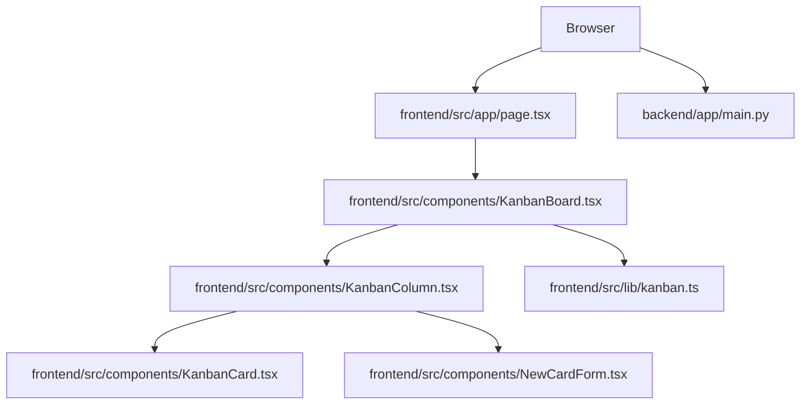

# Code Map

This file is a quick reference for how the current codebase fits together.

## Runtime Split

- `frontend/` is the Next.js Kanban demo.
- `backend/` is the FastAPI scaffold that serves a simple root page and health check.
- `scripts/` contains the cross-platform start and stop wrappers.
- `docs/PLAN.md` defines the intended build-out phases.

## Request Flow Today

## What Each Main File Owns

### Frontend

- [frontend/src/app/page.tsx](../frontend/src/app/page.tsx) mounts the board page.
- [frontend/src/components/KanbanBoard.tsx](../frontend/src/components/KanbanBoard.tsx) owns board state, drag-and-drop, rename, add, and delete handlers.
- [frontend/src/lib/kanban.ts](../frontend/src/lib/kanban.ts) defines the board types, seed data, card ids, and move logic.
- [frontend/src/components/KanbanColumn.tsx](../frontend/src/components/KanbanColumn.tsx) renders one column, its cards, and the add-card form.
- [frontend/src/components/KanbanCard.tsx](../frontend/src/components/KanbanCard.tsx) renders a sortable card and its delete action.
- [frontend/src/components/NewCardForm.tsx](../frontend/src/components/NewCardForm.tsx) handles card creation input.
- [frontend/src/components/KanbanCardPreview.tsx](../frontend/src/components/KanbanCardPreview.tsx) renders the drag overlay preview.

### Backend

- [backend/app/main.py](../backend/app/main.py) defines the FastAPI app and the current routes.
- [backend/tests/test_main.py](../backend/tests/test_main.py) verifies the root page and health endpoint.

### Tests

- [frontend/src/lib/kanban.test.ts](../frontend/src/lib/kanban.test.ts) checks board movement rules.
- [frontend/src/components/KanbanBoard.test.tsx](../frontend/src/components/KanbanBoard.test.tsx) checks rename, add, and delete behavior.
- [frontend/tests/kanban.spec.ts](../frontend/tests/kanban.spec.ts) checks the browser-level board flow.

## State Flow To Remember

1. The page loads `KanbanBoard`.
2. `KanbanBoard` seeds state from `initialData`.
3. User actions update local React state.
4. `KanbanColumn` and `KanbanCard` render from that state.
5. `moveCard` in `frontend/src/lib/kanban.ts` is the core pure helper for drag-and-drop ordering.

## Learning Shortcut

If you only have one hour, read these in order:

1. `docs/PLAN.md`
2. `frontend/src/lib/kanban.ts`
3. `frontend/src/components/KanbanBoard.tsx`
4. `frontend/src/components/KanbanColumn.tsx`
5. `frontend/src/components/KanbanCard.tsx`
6. `backend/app/main.py`
7. `frontend/src/lib/kanban.test.ts`
8. `frontend/tests/kanban.spec.ts`

## Current Gaps

- The board is still client-only.
- The backend does not yet persist board data.
- Login and AI chat are planned but not implemented.
- The Playwright spec lives under `frontend/tests/`, which is worth confirming with the team before changing the test layout.